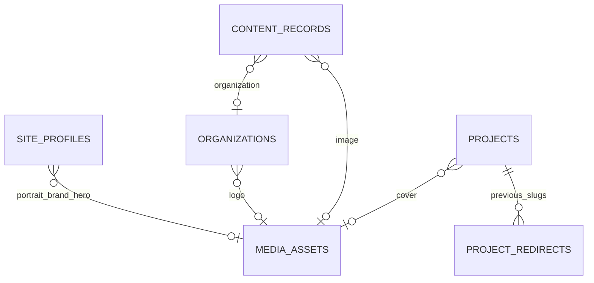

# Datamodel

[Terug naar de README](../README.md)

## Geïmplementeerde basis

Dit document beschrijft de huidige migrations en modellen. Het eerdere uitgebreide logische ontwerp is teruggebracht tot een compact CMS met gedeelde organisaties en een generiek contentrecord. Daardoor hebben cv-onderdelen, vaste pagina’s en handmatige cijfers dezelfde publicatieregels, zonder voor iedere soort een afzonderlijke tabel te onderhouden.

Lokaal draait SQLite. MySQL/MariaDB blijft het hostingdoel; de werkelijke hostversie en uitvoering van deze migrations op staging moeten nog worden gecontroleerd. Sleutels, timestamps en foreign keys volgen Laravel-conventies.

| Tabel | Belangrijkste velden | Gebruik |
| --- | --- | --- |
| `users` | `name`, `email`, `password`, `is_admin`, `is_active`, MFA-velden | Beheeraccount, los van de openbare profielgegevens |
| `site_profiles` | `key`, `name`, `headline`, `intro`, `biography`, `photo_media_id`, `brand_media_id`, `hero_media_id`, `settings` | Eén profiel met sleutel `main`; teksten en vormgeving |
| `organizations` | `name`, `website`, `logo_media_id` | Werkgevers, opleiders en verenigingen; naam uniek en logo gedeeld |
| `content_records` | `key`, `kind`, `title`, `organization_id`, `image_media_id`, `location`, `period`, `is_current`, `summary`, `data` | Cv, pagina’s, persoonlijke verhalen en handmatige statistieken |
| `projects` | `slug`, `name`, `domain`, `type`, `project_status`, `visual`, `headline`, `subheadline`, `role`, `started`, `summary`, `description`, `technologies`, `chapters`, `gallery`, `url`, `repository_url`, `cover_media_id`, `is_featured` | Projectoverzicht, detailpagina en uitgelichte kaarten |
| `media_assets` | `uuid`, `title`, `alt_text`, `caption`, `source_label`, `source_url`, `background`, `path`, `mime_type`, `width`, `height` | Private afbeeldingen met optioneel bijschrift, interne bron en lichte/donkere logodrager; UUID uniek |
| `project_redirects` | `old_slug`, `project_id` | Gereserveerde oude projectslugs; redirect volgt het huidige project |

Profiel, organisaties, contentrecords en projecten hebben `status`, `published_at`, `sort_order` en `deleted_at`, naast timestamps. Media kent geen eigen publicatiestatus: publieke toegang volgt de gepubliceerde verwijzingen. Media wordt definitief verwijderd als het nergens meer gekoppeld is. Frameworktabellen voor sessies, cache en taken blijven daarnaast bestaan.

## Publicatie

`HasPublication::scopePublished()` selecteert uitsluitend status `published` met een niet-leeg publicatiemoment dat niet in de toekomst ligt. De soft-delete-scope sluit verwijderde records uit. `isPublished()` gebruikt dezelfde voorwaarden voor een afzonderlijk record.

Nieuwe records beginnen als `draft`. `publish()` zet status en publicatiemoment. `archived`, `draft` en verwijderde records verschijnen niet publiek. Het portaal ondersteunt geen publicatieplanning of afzonderlijke revisies. De handmatige sortering gebruikt `sort_order` en een stabiele tweede sortering op ID; projecten zetten uitgelichte items eerst.

Deze regels gelden voor `PortfolioContent`, detailroutes, sitemap, media en de projectteller. Een beheerpreview mag één geselecteerd concept meenemen en blijft afgeschermd. Gekoppelde organisaties hebben hun eigen status; een verborgen organisatie geeft geen publieke naam of logo door.

## Inhoudssoorten

| `kind` | Inhoud van `data` / vaste sleutel |
| --- | --- |
| `work`, `volunteer`, `initiative` | `arrangement`, `responsibilities`; functietitel en periode in de hoofdvelden |
| `education`, `training` | `qualification_status`; titel, organisatie en periode in de hoofdvelden |
| `skill` | `items`, `icon`; titel is de naam van de vaardigheidsgroep |
| `language` | `code`, `level`; titel is de taalnaam |
| `page` | `heading`, `kicker`, `sections`; vaste sleutel `page:home/about/cv/projects/development/contact/privacy` |
| `world` | `note`; vaste sleutel `world:circuit/code/character`, optioneel eigen afbeelding |
| `statistic` | `value`, `unit`, `source`, `source_url`, `as_of` |

`key` is alleen voor vaste pagina’s en verhalen nodig en is uniek indien ingevuld. Het maakt geen willekeurige nieuwe routes aan. `summary` is de omschrijving of introductie. Tekst is gewone tekst en wordt ge-escaped weergegeven; gestructureerde hoofdstukken leveren koppen en alinea’s.

`period` en `started` zijn momenteel redactionele tekst. Er worden geen begin- en einddatums opgeslagen of afgeleide dienstjaren berekend. Een onbekende periode blijft leeg. Dit sluit aan op de geselecteerde cv-bronnen en voorkomt schijnnauwkeurigheid.

## Profielinstellingen

`site_profiles.settings` bevat:

- Kleurenschema, typografie, optionele hexkleuren en bewegingsschakelaar.
- Zichtbaarheid van persoonlijke verhalen, development en organisaties op home.
- Eigenschappen, interesses en herhaalbare haltes in het loopbaanverhaal.
- Introductiekop, kleine labels, persoonlijke noot en koppen bij het persoonlijke verhaal.
- Openbare contactlinks en footerteksten.

Persoonlijke afbeeldingen staan in afzonderlijke foreign keys. Naam en beheer-e-mail worden niet automatisch aan elkaar gekoppeld. Een publieke contactlink moet expliciet worden ingevuld.

## Relaties

Een projectgalerij bevat een geordende JSON-lijst met media-ID’s. Het model normaliseert deze naar integers voor consistente selectie. Dit is geen pivotrelatie en heeft geen database-FK per galerij-item. De mediacontrole voorkomt via de applicatie dat gekoppelde bestanden worden verwijderd; ook galerijen en verwijderde content worden meegenomen.

Het formulier gebruikt een eenvoudige repeater om die lijst te ordenen. `caption` verschijnt bij de projectbeelden; `source_label` en `source_url` blijven interne administratie. `background` kiest alleen een lichte of donkere drager bij gebruik als logo. Het sitethema wijzigt de merkkleuren niet.

## Validatie en opslag

- Formulieren begrenzen titels, koppen, teksten, herhalingen en slugs. Slugs gebruiken kleine letters, cijfers en koppeltekens.
- Website- en repositorylinks gebruiken HTTP(S). `mailto:` is alleen toegestaan bij expliciete contactlinks. Ruwe HTML en embedcode zijn geen contentvelden.
- Eigen kleuren gebruiken zes hextekens. De publieke service controleert deze vorm opnieuw voordat een waarde in CSS terechtkomt.
- Een statistiek vereist een numerieke waarde, bron en peildatum. Een meetmethode of GitHub-provider is nog niet configureerbaar.
- Organisatienamen, projectslugs, vaste inhoudssleutels, oude slugs en media-UUID’s zijn uniek.
- Een nieuwe projectslug mag niet gelijk zijn aan een gereserveerde oude slug. Een oude route werkt alleen als het doelproject gepubliceerd is.
- Afbeeldingen worden op bestandstype, omvang en afmetingen gecontroleerd, opnieuw opgebouwd als WebP en privé opgeslagen. Zie [Technisch ontwerp](technisch-ontwerp.md).
- Foreign keys verhinderen het definitief verwijderen van gekoppelde media. De applicatiecontrole neemt ook JSON-galerijen mee. Inhoud heeft soft delete; gedeelde bestanden worden nooit automatisch met inhoud verwijderd.

## Startimport

`PortfolioSeeder`, aangeroepen door `app:import-portfolio`, importeert de geselecteerde publieke gegevens uit `ResumeContent` en `PortfolioDesign`. De vaste sleutels en slugs maken de import herhaalbaar. Bestaande redactie en soft-deleted records worden behouden; er worden geen beheeraccounts gemaakt. De privéportretbron en latere uploads staan buiten Git.

De import vervangt geen back-up van database en media. Het aanpassen van een importklasse verandert een bestaand CMS-record niet automatisch.

`OrganizationLogoSeeder` vult lege logokoppelingen aan vanuit zeven voorbereide bronbestanden. Een gekozen eigen logo blijft behouden. `app:import-project-details` is een aparte, expliciete aanvulling voor de oorspronkelijke project-startteksten en de oprichtersrol bij DutchUnitedRacing. Alleen exact overeenkomende eerdere velden worden vervangen; eigen redactie en publicatiestatus blijven behouden. Zie [Projectinhoud](projectinhoud.md).

## Latere GitHub-uitbreiding

`integrations`, `statistic_snapshots` en `sync_runs` zijn nog niet gebouwd. Ze horen bij de toekomstige serverzijdige synchronisatie, met opgeslagen complete metingen en behoud van de laatste geslaagde waarde. De huidige kalender is een expliciete demonstratie. Meetdefinities en foutgedrag staan in [Statistieken](statistieken.md).

Credentials blijven in omgevingsconfiguratie. Er worden geen bezoekersprofielen, contactberichten, betalingen of blogtabellen vooruitlopend op mogelijke uitbreidingen toegevoegd.
