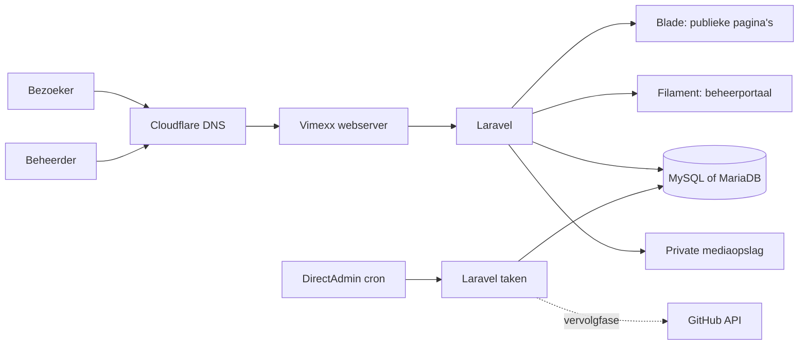

# Technisch ontwerp

[Terug naar de README](../README.md)

**Implementatiestatus:** de website leest nu gepubliceerde CMS-gegevens via `PortfolioContent`. Vijf Filament-resources beheren profiel en vormgeving, cv/pagina’s/cijfers, organisaties, projecten en afbeeldingen. Gedeelde publicatieregels gelden voor online en print, detailroutes, sitemap, media en projectteller. Preview en private media vereisen een actieve beheerder met ingestelde MFA. De lokale database is gemigreerd en de geselecteerde startinhoud is expliciet geïmporteerd. Hosting, definitieve SEO-inrichting en automatische GitHub-statistieken zijn vervolgstappen. Zie [Je website beheren](beheerportaal.md), [Ontwerpoplevering](ontwerpoplevering.md) en [Datamodel](datamodel.md).

## Architectuur

We bouwen één Laravel-applicatie. Publieke pagina's, beheersessies, inhoud, media en statistieken gebruiken dezelfde database en dezelfde publicatieregels. Inhoudswijzigingen zijn direct te publiceren zonder een nieuwe frontendbuild.



Het DNS-blok stelt de naamresolutie voor. Bij ingeschakelde Cloudflare-proxy loopt ook het HTTP-verkeer via Cloudflare. Dat is nog geen bevestigde instelling van het account.

## Frameworks en versies

Voorkeursbasis op de ontwerpdatum:

| Onderdeel | Keuze | Reden |
| --- | --- | --- |
| PHP | 8.3 of hoger, binnen de door dependencies ondersteunde versies | Sluit aan op Laravel 13 en de gepubliceerde Vimexx-mogelijkheden |
| Laravel | 13.x | Routing, validatie, authenticatie, database, opslag en geplande taken in één framework |
| Filament | 5.x Panel Builder | Geschikt voor gestructureerde beheerformulieren en tabellen |
| Livewire | 4.x, vastgelegd met Filament 5 | Interactie in het portaal |
| Frontend | Blade en Tailwind CSS 4.1+ | Serveropgebouwde pagina's met een eigen vormgeving |
| Bundler | Vite | CSS en JavaScript als versieerbare statische bestanden opleveren |
| Database | Lokaal SQLite; MySQL/MariaDB als hostingdoel | Eerste start zonder extra service; CI geconfigureerd voor SQLite en MySQL |
| Tests | Pest of PHPUnit, passend bij het skelet | Functionele checks op publicatie, toegang en gegevensverwerking |

Laravel 13 vereist minimaal PHP 8.3 volgens de [release-informatie](https://laravel.com/framework/docs/13.x/releases). Filament 5 documenteert zijn installatievereisten in de [officiële installatiehandleiding](https://filamentphp.com/docs/5.x/introduction/installation). De combinatie is met Composer geïnstalleerd; `composer.lock` en `package-lock.json` leggen de werkelijk gebruikte versies vast. Het Composer-platform is op PHP 8.3.0 gericht, terwijl de lokale runtime PHP 8.4 gebruikt.

Een ondersteunde databaseversie wordt op het account gecontroleerd. De [Laravel-databasedocumentatie](https://laravel.com/framework/docs/13.x/database) beschrijft technische compatibiliteit; compatibiliteit alleen zegt niet of een oude databaseserver nog beveiligingsondersteuning krijgt. Een verouderde accountversie bespreken we met Vimexx voordat productie wordt ingericht.

## Verdeling van verantwoordelijkheden

- **Routes en controllers:** HTTP-verzoeken, publieke pagina's en reacties.
- **Models en query scopes:** gegevens, relaties en één herbruikbare definitie van gepubliceerde inhoud.
- **Policies en middleware:** beheertoegang, previews, uploads en publicatieacties.
- **Filament-resources:** beheerformulieren, validatiefouten, lijsten en acties.
- **Blade-componenten:** navigatie, tijdlijnen, projectonderdelen en statistiekweergave.
- **Services/actions:** publicatie, media-afhandeling en later GitHub-synchronisatie waar gedeelde logica nodig is.
- **Artisan-commando's:** gecontroleerde beheertaken en korte, geplande synchronisatie.

We gebruiken de gangbare Laravel-projectstructuur. Extra abstractielagen worden pas toegevoegd als meerdere plekken werkelijk dezelfde logica nodig hebben.

## Publieke interactie en beweging

De publieke vormgeving gebruikt gewone JavaScript in `resources/js/app.js`; er is geen extra animatiebibliotheek nodig. De Blade-component `personal-world` levert alle persoonlijke teksten in de HTML-response. JavaScript activeert de drie verhaalkeuzes en verbergt vervolgens de niet-geselecteerde panelen. Zonder JavaScript blijven de verhalen leesbaar.

De circuitillustratie is inline SVG. Een door de bezoeker gestart rondje volgt de getekende baan met `requestAnimationFrame` en SVG-puntberekening. Het rondje kan worden gepauzeerd en hervat; `IntersectionObserver` en de paginazichtbaarheid stoppen beweging buiten beeld. Een rondje loopt niet automatisch opnieuw.

Projectgalerijen gebruiken een native `dialog` met toetsenbordbediening, Escape en terugkerende focus. Zonder JavaScript blijven de gewone links naar de gecontroleerde afbeeldingsroute beschikbaar. Bijschriften staan in de eerste HTML-response. De publieke afbeeldingsdata bevat geen interne bronlink. Het portaal bewaart galerijvolgorde als een eenvoudige lijst media-ID’s.

Diepte-effecten zijn beperkt tot een fijne muisaanwijzer. `prefers-reduced-motion` en de profielinstelling `motion` schakelen ze uit; een veranderde bezoekersvoorkeur wordt tijdens het bezoek gevolgd. De rondjeknop toont dan direct de eindtoestand. Verhaalkeuzes gebruiken gewone knoppen met `aria-pressed`, gekoppelde panelen en zichtbare focus. Alleen gepubliceerde verhalen verschijnen. Bewegende decoratie is geen bron van noodzakelijke informatie. Zie [Vormgeving en content](vormgeving-en-content.md) voor de persoonlijke richting en [Ontwerpoplevering](ontwerpoplevering.md) voor de browsercontrole.

## Projectstructuur

```text
app/
  Console/Commands/         # Eenmalige en geplande taken
  Filament/                 # Beheerresources, pagina's en widgets
  Http/Controllers/         # Publieke pagina's, preview en media
  Models/                   # Inhoud, relaties en scopes
  Http/Middleware/          # Expliciete beheertoegang voor preview en media
  Services/                 # Media; later GitHub
bootstrap/
config/
database/
  factories/
  migrations/
  seeders/                  # Expliciete startimport; geen standaardaccounts
docs/
public/                     # Enige openbare documentroot
resources/
  css/
  js/
  views/
routes/
storage/                    # Private runtimegegevens, niet in Git
tests/
  Feature/
  Unit/
```

`PortfolioContent` selecteert en vertaalt de database-inhoud voor Blade. `HasPublication` bevat de publieke scope. `ImageStorage` controleert uploads en bouwt WebP-versies opnieuw op. `RequireContentAdmin` beveiligt de preview- en beheermediaroutes. `PortfolioSeeder` gebruikt de geselecteerde inhoud in `app/Support/` als herhaalbare startimport; deze klassen worden niet meer door de publieke controllers als inhoudsbron gebruikt.

## Authenticatie en beheer

Het portaal gebruikt Laravel-sessies en Filament-authenticatie met een expliciete controle op een actief beheeraccount. Er is geen publieke registratie. Een beheerder wordt interactief via een servercommando aangemaakt; er staan geen standaardwachtwoorden in seeders of documentatie.

TOTP via een authenticator-app is verplicht voordat de beheerder inhoud kan beheren. Gebruik de [MFA-voorzieningen van Filament](https://filamentphp.com/docs/5.x/users/multi-factor-authentication), inclusief herstelcodes. Het gegevensmodel volgt de door de gekozen versie voorgeschreven opslag en contracten. Sla het TOTP-geheim versleuteld op en behandel herstelcodes volgens de beveiligde frameworkvoorziening.

Aanmelden en herstelverzoeken krijgen snelheidsbeperking. Cookies zijn in productie `Secure`, `HttpOnly` en krijgen een passende `SameSite`-instelling. Formulieren gebruiken de frameworkbescherming tegen vervalste verzoeken. Sessies worden vernieuwd na aanmelden en ongeldig gemaakt bij afmelden. Een eventueel wachtwoordherstel via e-mail komt pas beschikbaar als SMTP is ingericht en getest; serverherstel blijft gedocumenteerd.

De applicatiesleutel blijft behouden tussen deployments en hoort bij het herstelplan. Vertrouw proxyheaders alleen van de gecontroleerde proxyketen; een bezoeker mag niet zelf via een header een betrouwbaar IP-adres of HTTPS-status bepalen.

## Publicatie en tekstinhoud

Een gedeelde `published`-scope controleert status, publicatiedatum en logische verwijdering. Publieke pagina's, sitemap, mediatoegang en interne tellers gebruiken diezelfde regels. `published_at` ligt in versie één niet in de toekomst; geplande publicatie valt buiten scope.

Teksten worden als gewone tekst opgeslagen en door Blade ge-escaped weergegeven. Biografie en projectbeschrijving ondersteunen alinea’s; herhaalbare hoofdstukken leveren gestructureerde koppen en tekst. Er is geen Markdown- of HTML-editor. Links hebben toegestane protocollen. Het portaal laat geen willekeurige scripts, iframe-embeds of HTML-blokken invoeren.

Nieuwe records beginnen als concept. Publiceren valideert en bewaart het formulier en zet daarna status en publicatiemoment. Bij gepubliceerde records benoemt de opslaanknop expliciet dat de wijziging ook gepubliceerd wordt. Er is geen afzonderlijke revisietabel. Publieke inhoud wordt per verzoek uit de database gelezen; er is nog geen contentcache om ongeldig te maken. Een gewijzigd projectadres krijgt een `project_redirects`-record; het formulier reserveert oude slugs en een ingetrokken project geeft ook via een oude slug 404.

## Mediaopslag

Uploads staan op de private lokale Laravel-disk. `ImageStorage` accepteert JPEG, PNG en WebP tot 5 MB en 16 miljoen pixels, gebruikt GD om de afbeelding opnieuw op te bouwen en beperkt de langste zijde tot 2400 pixels. Het resultaat krijgt een willekeurige naam onder `storage/app/private/portfolio/`. Metadata en het tussentijdse uploadbestand worden verwijderd; transparantie blijft behouden. GD moet ook op de host beschikbaar zijn. De generieke lokale bestandsroute is uitgeschakeld.

De eerste release levert media via een controller:

- Beheer en preview vereisen authenticatie; de response is `private, no-store`.
- Een publieke afbeeldingsroute levert alleen een veilige variant die aan gepubliceerde inhoud of actieve publieke instellingen hangt.
- De originele upload en interne bestandspaden zijn nooit rechtstreeks publiek bereikbaar.
- Ook publieke media krijgt voorlopig `private, no-store` en `nosniff`; Cloudflare krijgt geen regel om de toegangscontrole te omzeilen.
- Een niet-gepubliceerde of verwijderde koppeling geeft geen publieke toegang, tenzij hetzelfde bestand elders bewust gepubliceerd is.

Een bestand dat al openbaar is gedeeld, kan door bezoekers zijn opgeslagen. Intrekken voorkomt nieuwe levering door de applicatie, maar kan zulke kopieën niet terughalen. Persoonlijke bewijsstukken worden daarom niet als normale publieke afbeeldingen gebruikt.

## Sessies, cache en geplande taken

Databasesessies en databasecache zijn lokaal ingesteld. Zo zijn sessies, snelheidslimieten en toekomstige taaklocks niet gekoppeld aan een tijdelijke releasemap. Dit vraagt geen extra Redis-dienst. Publieke content heeft momenteel geen aanvullende readmodelcache.

Publieke HTML krijgt aanvankelijk geen Cloudflare- of Varnish-paginacache. Alleen bestanden uit de versiegebonden assetbuild krijgen een lange cacheduur. Intern kunnen readmodels kort worden gecachet, met expliciete invalidatie na publicatie. Beheer, previews en loginresponses worden nooit als publieke pagina gecachet.

Voor de GitHub-fase draait een kort synchronisatiecommando via de Laravel-scheduler. Voorkom overlap met een gedeelde lock, stel time-outs en een maximale looptijd in en gebruik een begrensde retrystrategie. Een blijvende queueworker is geen voorwaarde voor de eerste release.

## Zoekmachines en prestaties

Alle hoofdinhoud staat in de eerste HTML-response. Titels en beschrijvingen volgen de pagina-inhoud; de sitemap bevat alleen gepubliceerde pagina’s en projecten. De lokale versie blijft `noindex, nofollow`. Definitieve canonieke links, deelmetadata, gestructureerde gegevens en indexeerbaarheid moeten vóór livegang worden afgerond. Gebruik `Person`- of projectgerelateerde gegevens alleen voor feiten die werkelijk op de pagina staan.

Afbeeldingen krijgen passende formaten en breedte/hoogte. Onder de eerste schermhoogte worden ze waar passend lui geladen. Eager loading voorkomt een databasequery per project of vaardigheid. API-aanroepen naar externe statistiekbronnen vinden nooit plaats tijdens het laden van een publieke pagina.

## Contactformulier en privé-inbox

`POST /contact` gebruikt dezelfde profiel- en paginapublicatieregels als de publieke pagina. Validatie begrenst velden; CSRF, een honeypot en de named limiter `contact` beperken misbruik. De pagina krijgt `private, no-store` vanwege formulier- en sessiegegevens. Ook bij Cloudflare/Varnish moet `/contact` buiten paginacaching blijven.

`ContactMessage` bewaart naam, e-mailadres, onderwerp, bericht en afhandelstatus in een afzonderlijke tabel. Er zijn geen publieke lees-, export- of media-endpoints voor berichten. Filament biedt lezen, antwoorden via een `mailto:`-actie, afhandelen en definitief verwijderen; actieve beheerrechten en de bestaande MFA blijven verplicht. Bezoekersinhoud wordt als tekst ge-escaped, niet als HTML gerenderd. SMTP en e-mailnotificaties zijn niet onderdeel van deze uitbreiding.

De dagelijkse scheduler plant het verwijderen van berichten ouder dan 90 dagen. Dit werkt pas met een aantoonbaar uitgevoerde hostingcron; handmatig opschonen blijft mogelijk. De actuele updatehulp accepteert uitsluitend de aanvullende migration `2026_10_20_000001_create_contact_messages_table` boven op de eerdere GitHub-release; het eerder geüploade exemplaar moet worden vervangen. Zie [de releaseprocedure](release-contactformulier.md).

## Logging en foutgedrag

In productie staat debugweergave uit. Een 404 toont een bruikbare terugweg; een interne fout toont geen stacktrace. Log de noodzakelijke foutcontext zonder wachtwoorden, tokens, sessiegegevens of volledige privé-API-antwoorden. Rotatie en bewaartermijn worden bij deployment ingesteld.

Een onderhoudspagina en een beperkte healthcheck ondersteunen deployments. De healthcheck geeft alleen een status terug; accountgegevens, dependencyversies en serverpaden worden niet getoond.
